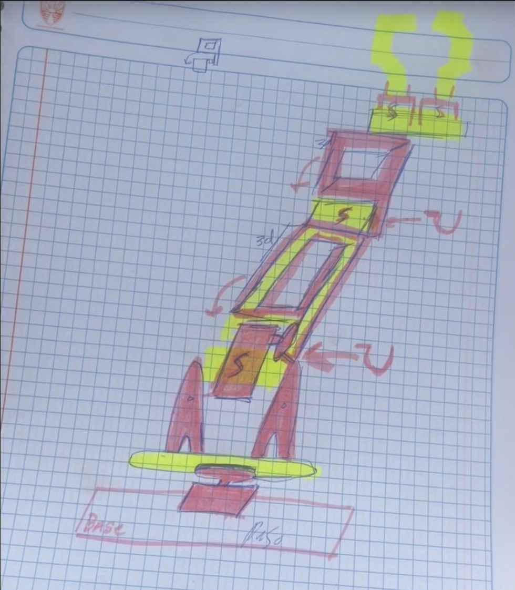
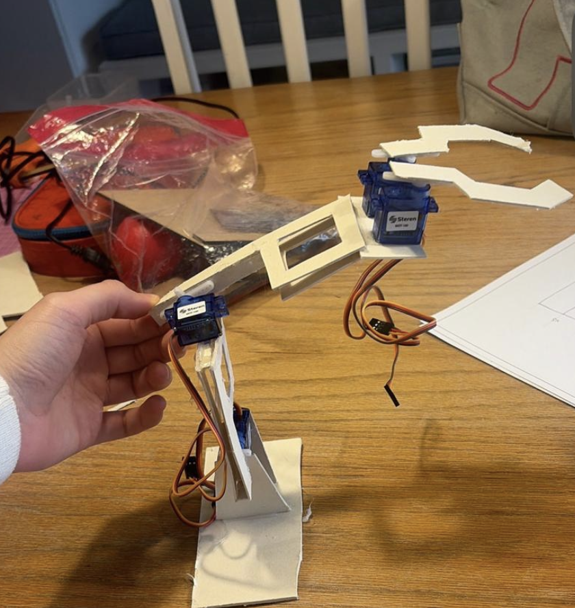
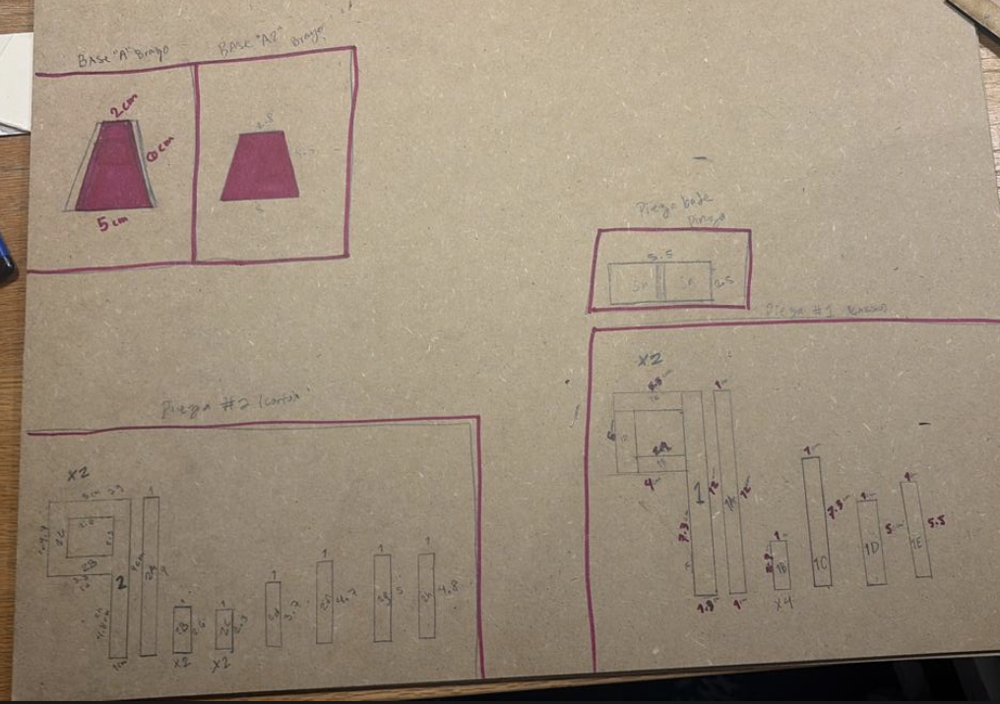
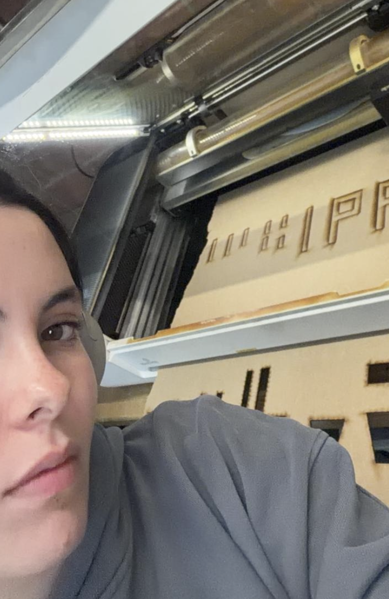
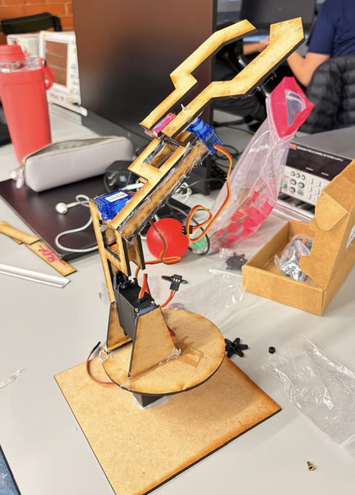
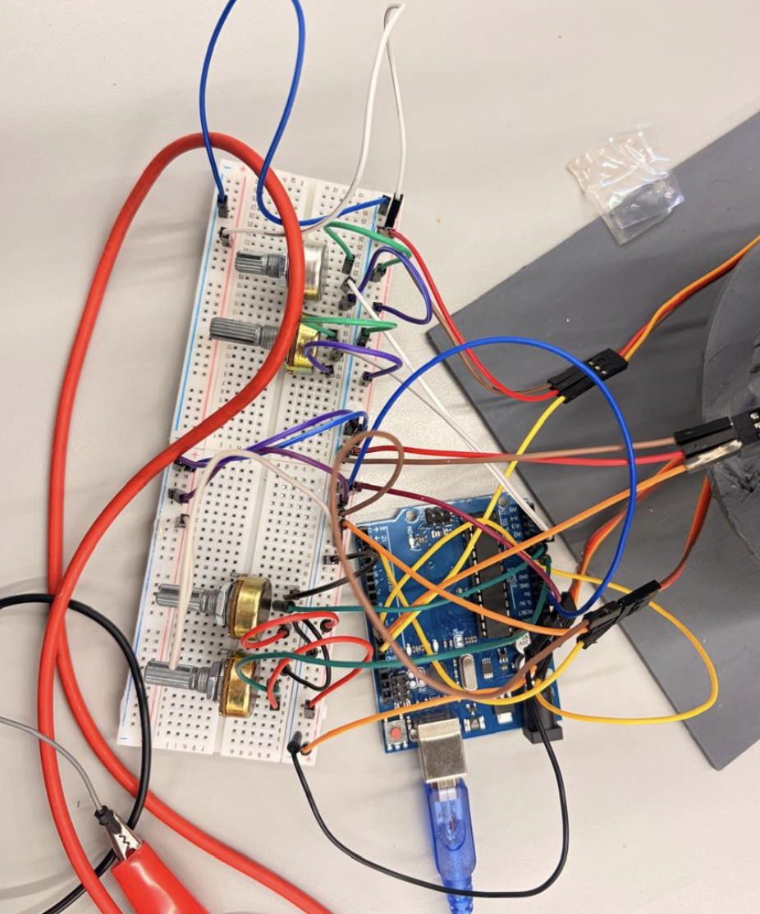
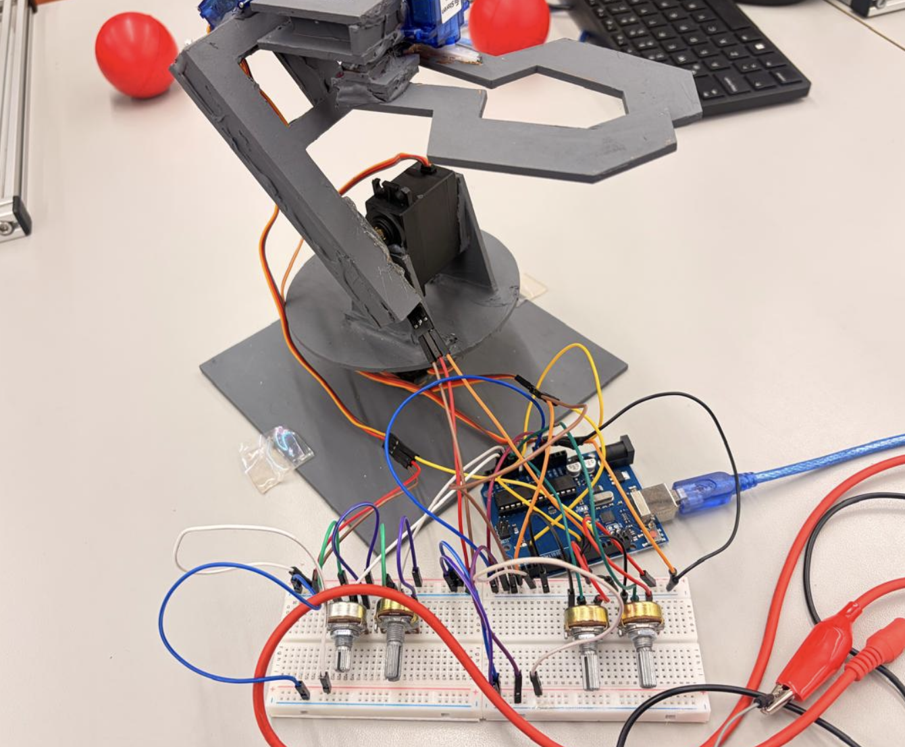
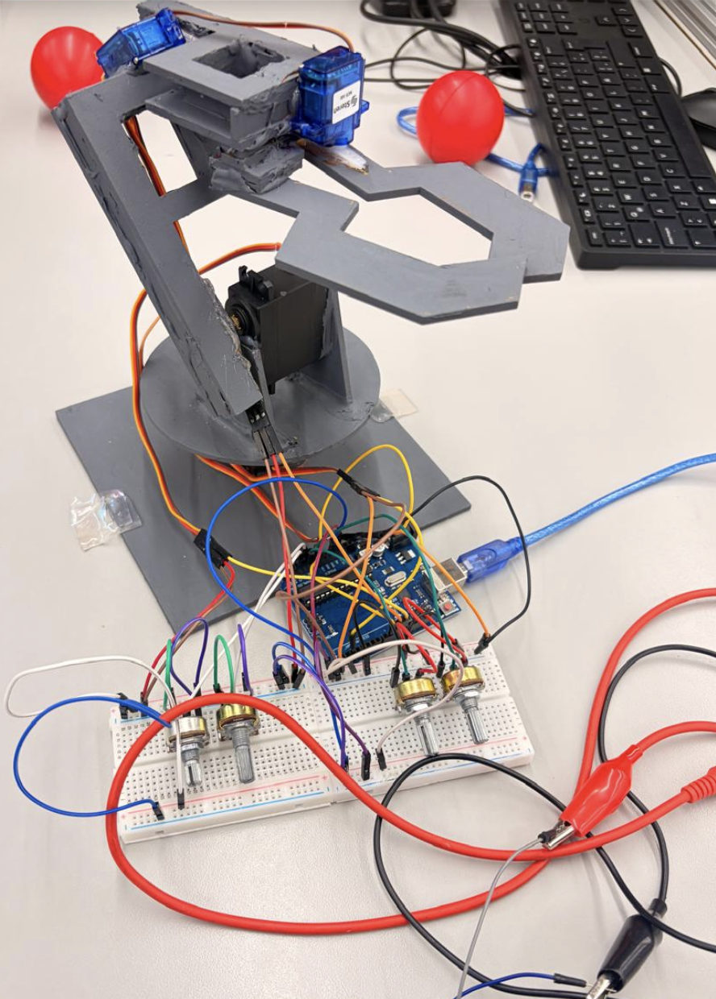
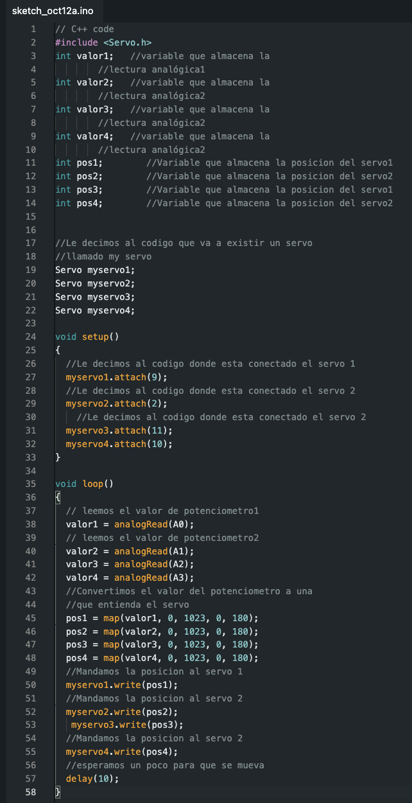
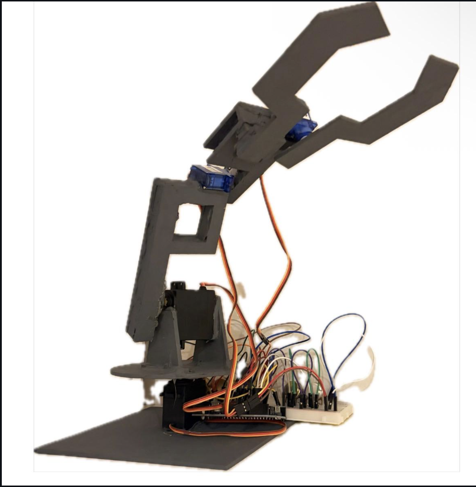

# Mi proceso para hacer un brazo robot

**Sketches y maquetas**

Antes de empezar con el proyecto, se me vino una idea a la cabeza, entonces hice un sketch. Se me ocurrió hacer una maqueta de cartón para verificar que el mecanismo hiciera sentido.

-----

**Modelaje y corte lazer**

Aunque no tengo una foto del modelaje en Solidworks, tengo foto de las medidas que utilicé. Luego procedí a ir al taller para cortar las piezas de madera.

-----

**Armado**

Ya que tenía todas las piezas, procedí a armar el brazo con silicón caliente; todas las medidas fueron correctas y todo iba en pie.

-----

**Proceso**

Después del armado, estas son algunas fotos del proceso: lo pinté de gris, y en estas fotos se puede ver el proceso de programación a prueba y error con el proto, los pots, y todos los materiales. También incluí un video donde se puede ver como intento programar el brazo.

<video controls width="720">
  <source src="../assets/videos/VPROG.mp4" type="video/mp4">
  Tu navegador no soporta video HTML5.
</video>

-----

**CÓDIGO**

Éste es el código que utilicé para programar el brazo; se trabajó en Arduino UNO.

-----

**Video final individual**

En este video se puede ver a mi brazo cumpliendo el requerimiento de levantar la pelota por 5 segundos. Aparte de esto, se puede ver como se mueven bien todos los grados de libertad incluidos.

<video controls width="720">
  <source src="../assets/videos/ROBOTINDIVIDUAL.mp4" type="video/mp4">
  Tu navegador no soporta video HTML5.
</video>

-----

**Video final equipo**

En este video se puede ver a mi brazo pasando la pelota al brazo de otros compañeros. El requerimiento para sacar el 10; trabajo en equipo.

<video controls width="720">
  <source src="../assets/videos/VIDEOEQUIPO.mp4" type="video/mp4">
  Tu navegador no soporta video HTML5.
</video>

-----

**Foto final brazo robot**

Esta es la foto clara del resultado final de mi brazo robot.

